<a href="https://www.linkedin.com/in/rahul-misala-20a94524a">LinkedIn</a> · <a href="https://elofychess.com">ELOFY</a> · <a href="mailto:rahulmisala416@gmail.com">rahulmisala416@gmail.com</a>

